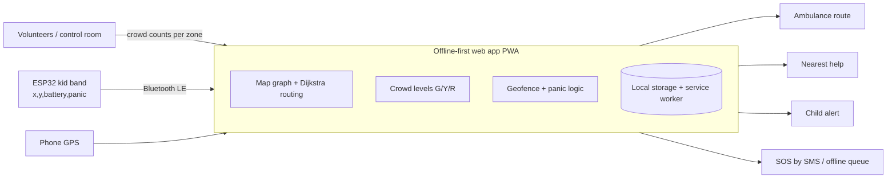
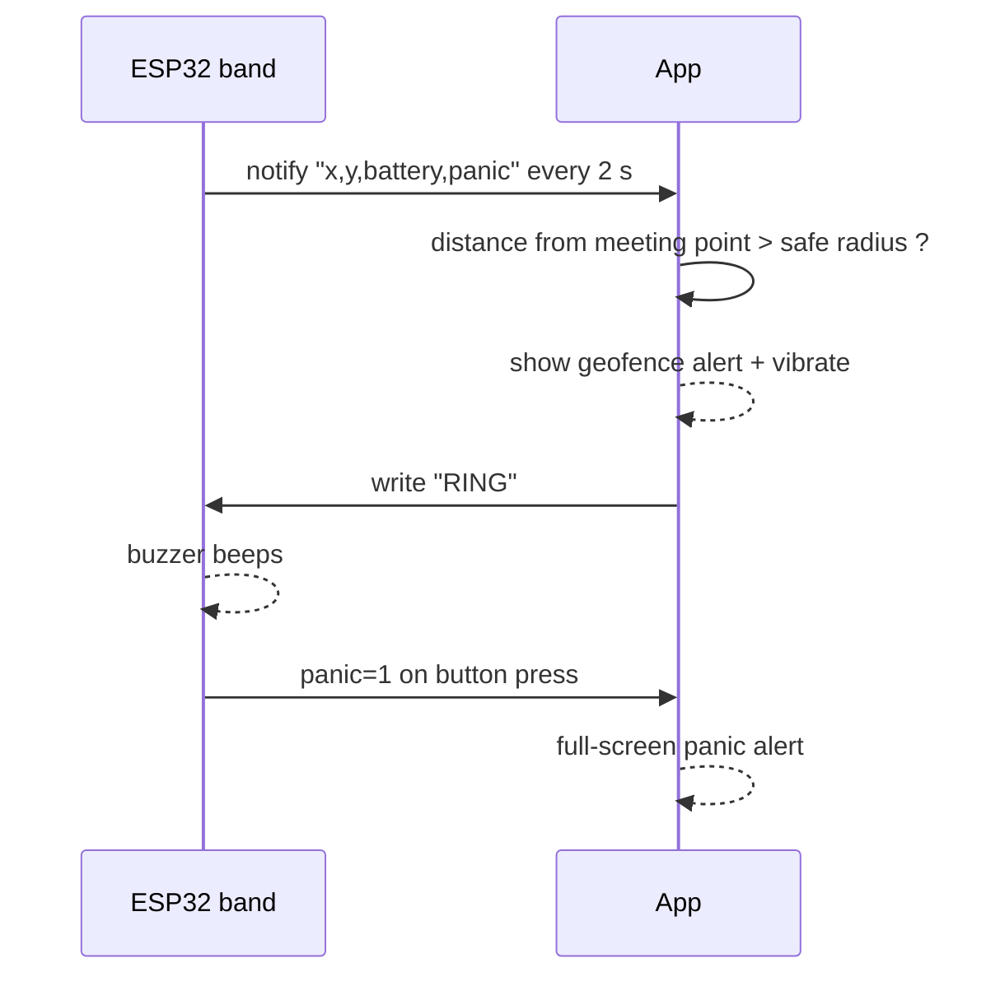

# Technical Design Document: Kumbh Rakshak

## 1. Goals
- Keep working when mobile networks jam (offline-first).
- Give pilgrims, ambulances and volunteers the same live view of crowd levels.
- Alert parents when a child leaves a safe zone or presses the panic button.

## 2. System overview

## 3. Components
| Component | Technology | Responsibility |
|---|---|---|
| Web app | HTML/JavaScript PWA, service worker, localStorage | UI, offline data, routing, geofence, SOS queue |
| Routing | Dijkstra on a junction graph | Shortest path with crowd penalty |
| Kid band | ESP32, Arduino C++, BLE (optional GPS NEO-6M) | Send position, battery, panic; ring on request |
| Bridge | Web Bluetooth API (Android Chrome) | Connect band to app |
| C prototype | C99 | Console version of the core logic, used for automated tests |

## 4. Crowd levels
| People in zone | Level |
|---|---|
| below 200 | Green |
| 200 to 399 | Yellow |
| 400 or more | Red |

## 5. Crowd-aware routing
Edge cost = road length x multiplier, using the worse level of the two end zones.

| Level | Pilgrim multiplier | Ambulance multiplier |
|---|---|---|
| Green | 1 | 1 |
| Yellow | 2 | 1.5 |
| Red | 6 | 3 |

Ambulances get a smaller penalty because sirens and volunteers can clear a lane.
When offline, the last known crowd levels (with their timestamp) are used.

## 6. Kid band protocol

- Service UUID `6e400001-b5a3-f393-e0a9-e50e24dcca9e`
- Notify characteristic `6e400003-b5a3-f393-e0a9-e50e24dcca9e` (message under 20 bytes)
- Write characteristic `6e400002-b5a3-f393-e0a9-e50e24dcca9e`
- No data for 10 seconds is treated as "band out of range".

## 7. SOS flow
1. User holds the SOS button for 1.5 seconds.
2. App reads GPS (or the last saved location).
3. App opens an SMS prefilled with the Google Maps link to the police, ambulance and family contact.
4. If there is no network, the SOS is stored in a local queue and flushed when the device is back online.

## 8. Privacy and safety
- No faces or personal identification are processed.
- Child location is shown only to the registered parent device and volunteers they alert.
- No data leaves the device except the SMS the user sends.

## 9. Limitations and future work
- Web Bluetooth is not available on iPhone; a QR/NFC wristband is the fallback.
- Crowd data is volunteer-entered or simulated in the demo.
- Planned: LoRa + GPS band, regional languages, camera or drone crowd counting.
